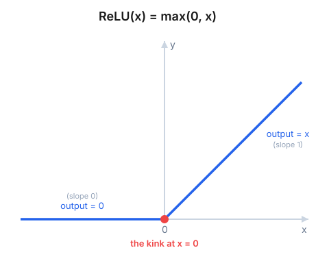
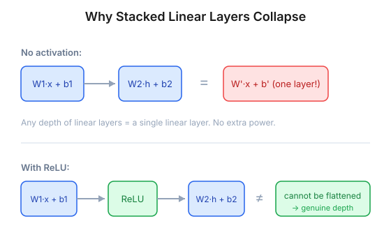
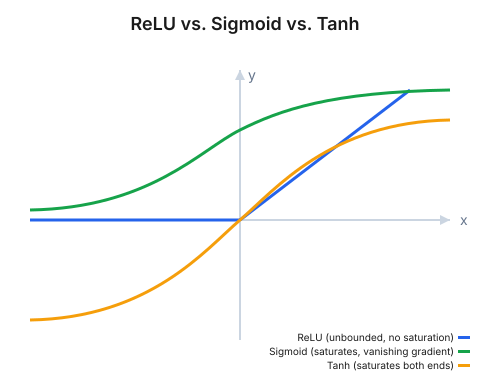

ReLU is the default activation function in most modern architectures:

```
ReLU(x) = max(0, x)
```

Positive inputs pass through unchanged and negative inputs become zero. The usual objection is immediate: that's two straight lines, so how is it non-linear?



## Two straight lines can still be non-linear

The confusion comes from what "linear" means. A function `f` is linear if it is additive, `f(a + b) = f(a) + f(b)`, and homogeneous, `f(c · x) = c · f(x)`. Being made of straight segments is not part of the definition.

ReLU fails additivity. Take `a = 3` and `b = -5`: `ReLU(a + b) = ReLU(-2) = 0`, but `ReLU(a) + ReLU(b) = 3 + 0 = 3`. It also fails homogeneity for negative scalars: with `x = 2` and `c = -1`, `ReLU(c · x) = 0` but `c · ReLU(x) = -2`. (For `c ≥ 0` it passes, which is why additivity is the cleaner counterexample.)

So ReLU is piecewise linear but not linear. The slope jumps from 0 to 1 at the origin, and no single line `m·x + b` can reproduce that. The kink acts as a gate: the neuron responds on one side and stays silent on the other. A linear function can't switch like that.

## Without an activation, layers collapse into one

A layer computes a weighted sum followed by an activation:

```
output = activation(W · x + b)
```

The `W · x + b` part is affine. Stack two layers with no activation and they collapse:

```
h2 = W2 · (W1 · x + b1) + b2
   = (W2 · W1) · x + (W2 · b1 + b2)
```

Define `W' = W2 · W1` and `b' = W2 · b1 + b2`, and the two layers are one layer, `W' · x + b'`. This holds for any depth, so a hundred-layer network without activations is no more expressive than a single affine map. It can only learn straight lines and flat hyperplanes.

## XOR is where a straight line fails

XOR is the smallest problem that shows the limit. It returns 1 only when its two binary inputs differ, so the 1s sit at `(0,1)` and `(1,0)` and the 0s at `(0,0)` and `(1,1)`. No single straight line separates them, which is why the single-layer perceptron couldn't learn it. A ReLU hidden layer with two units can:

```
h1 = ReLU(x1 + x2)
h2 = ReLU(x1 + x2 - 1)
y  = h1 - 2 · h2
```

- `(0,0)`: `h1 = 0`, `h2 = 0`, `y = 0` ✓
- `(0,1)`: `h1 = 1`, `h2 = 0`, `y = 1` ✓
- `(1,0)`: `h1 = 1`, `h2 = 0`, `y = 1` ✓
- `(1,1)`: `h1 = 2`, `h2 = 1`, `y = 0` ✓

The unit `h2` does the real work. It stays at zero until both inputs are on, then switches on and subtracts the "both" case. No linear combination of the inputs can express that conditional.

## What happens once ReLU sits between layers



With ReLU between layers, the network can no longer be flattened into one map. Each unit bends the input space, and stacking them carves it into many regions, each with its own linear behavior. That is the intuition behind the universal approximation theorem: enough of these pieces can approximate essentially any continuous function.

## Why ReLU won out over sigmoid and tanh

Any non-linearity would break the collapse, so why ReLU? It's cheap, with one comparison and no exponentials. Its gradient is 1 for positive inputs, so it avoids the vanishing gradients that sigmoid and tanh produce when they saturate. And it outputs exact zeros, so many neurons are inactive at any moment, giving sparse representations. (The derivative at exactly 0 is undefined; frameworks conventionally use 0.)



## When a ReLU neuron dies

The flat negative region has a cost. If a neuron's pre-activation `W · x + b` is negative for every example, its output is always zero and its gradient is always zero, so backpropagation never updates its weights. The neuron stays negative and never recovers. This typically follows a large update, often from a high learning rate, that pushes the bias far negative, or from an unlucky initialization.

Leaky ReLU avoids this by giving the negative side a small slope:

```
LeakyReLU(x) = max(0.01 · x, x)
```

A neuron pushed negative still receives a small gradient and can recover. PReLU takes the idea further by learning the slope.

ReLU looks too simple to be non-linear, but linearity is about preserving addition and scaling, not about how a graph looks. One bend at the origin breaks both, and that is what lets a stack of matrix multiplications learn curved, non-trivial functions.